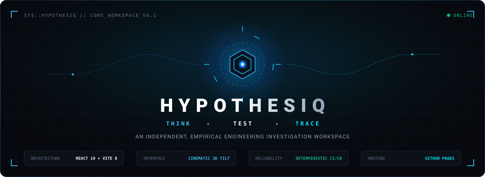
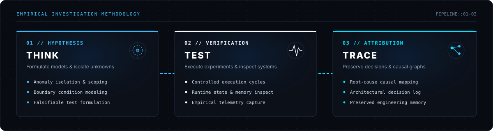
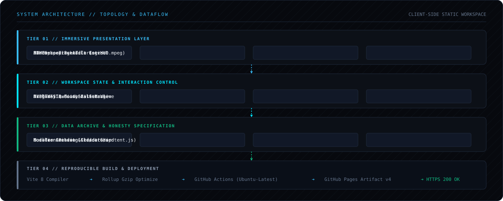
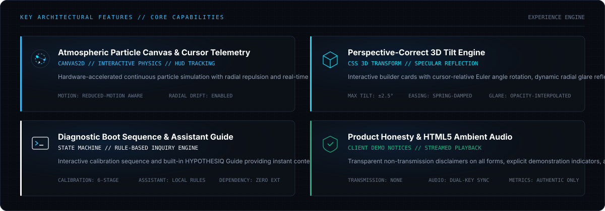
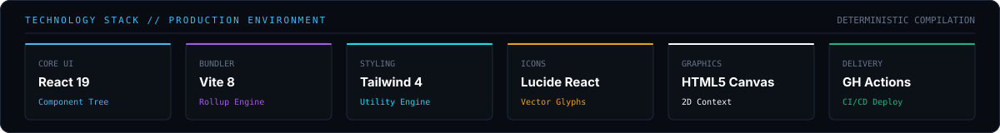

<div align="center">



<br />
<br />

[](https://github.com/pranjalisantani/hypothesiq/actions/workflows/deploy.yml)
&nbsp;
[](https://pranjalisantani.github.io/hypothesiq/)
&nbsp;
[](https://react.dev/)
&nbsp;
[](https://vite.dev/)
&nbsp;
[](https://github.com/pranjalisantani/hypothesiq)

<br />

**[Explore Live Workspace ↗](https://pranjalisantani.github.io/hypothesiq/)** &nbsp;&bull;&nbsp; **[System Architecture](#-system-architecture)** &nbsp;&bull;&nbsp; **[Core Features](#-architectural-capabilities)** &nbsp;&bull;&nbsp; **[Local Setup](#-engineering-setup)**

</div>

---

## 🔬 Overview & Thesis

**HYPOTHESIQ** is an independent, client-side engineering investigation workspace designed for systems builders, technical researchers, and software engineers who demand rigor and empirical clarity in complex software environments.

Modern technical problem-solving frequently suffers from fragmented context: developers jump between terminal outputs, source repositories, documentation, and speculative hypotheses without a structured cognitive framework. **HYPOTHESIQ** bridges this divide by providing a unified, empirical environment centered on structured reasoning:

<br />

<div align="center">
  
</div>

<br />

1. **Think // Hypothesis Formulation**: Establish falsifiable premises, isolate unknown parameters, and model system boundaries before touching production state.
2. **Test // Empirical Verification**: Execute reproducible experiments, capture runtime telemetry, and observe state deviations under controlled conditions.
3. **Trace // Causal Attribution**: Map anomalies directly to root causes, record immutable architectural decisions, and preserve reusable engineering memory.

---

## 🏛️ System Architecture

HYPOTHESIQ is constructed as an optimized, zero-backend static client application with predictable state transitions, hardware-accelerated graphics, and deterministic continuous deployment.

<br />

<div align="center">
  
</div>

<br />

### Architectural Breakdown

```
hypothesiq/
├── .github/
│   ├── assets/                 # High-resolution vector diagrams and presentation artwork
│   └── workflows/
│       └── deploy.yml          # GitHub Actions CI/CD (Ubuntu → Node.js → Vite → Pages)
├── public/
│   ├── assets/                 # Static media assets, avatars, and audio buffers
│   └── favicon.svg             # Precision geometric workspace favicon
├── src/
│   ├── data/
│   │   └── content.js          # Normalized workspace data, taxonomy, builder registry
│   ├── App.jsx                 # Workspace coordinator, telemetry HUD, modal controllers
│   ├── components.jsx          # Modular UI components: Navigation, Cards, Dialogs, Guide
│   ├── styles.css              # Custom styling definitions and glassmorphic depth layers
│   └── main.jsx                # React 19 root bootstrap & performance calibration
├── index.html                  # HTML5 entry with preconnected typography engines
├── vite.config.js              # Production base-path routing and rollup chunking
└── package.json                # Project manifest, scripts, and production dependencies
```

---

## ⚡ Architectural Capabilities

<div align="center">
  
</div>

<br />

### 1. Atmospheric Particle Canvas & Telemetry HUD
* **Continuous Particle Simulation**: Custom HTML5 Canvas engine computing real-time coordinate drift and pointer repulsion with reduced-motion support.
* **Hardware-Tracked Cursor HUD**: Dynamic viewport coordinate telemetry, real-time tracking metrics, and state-reactive cursor rings.

### 2. Perspective-Correct 3D Tilt Engine
* **Euler Angle Perspective Transform**: Hardware-accelerated CSS 3D matrix transformations dynamically interpolated relative to cursor position.
* **Dynamic Specular Glare**: Angle-reactive lighting simulation creating depth and realistic materiality across builder cards.

### 3. Diagnostic Boot Sequence & HYPOTHESIQ Guide
* **State Machine Initialization**: 6-stage workspace initialization sequence simulating realistic systems initialization.
* **Local Rule-Based Assistant**: Client-side inquiry engine providing immediate navigation, context routing, and workspace architecture assistance without external API latency.

### 4. Spatial Ambient Audio & Product Honesty by Design
* **HTML5 Looping Audio**: Audio stream engine playing `assets/audio/struct.mpeg` with cross-session dual-key `localStorage` preference retention.
* **Transparent Disclaimers**: Clear client-side demonstration indicators, explicit non-transmission notices on inquiry inputs, and authentic metrics.

---

## 🛠️ Technology Stack

<div align="center">
  
</div>

<br />

| Technology | Version | Purpose & Architectural Role |
| :--- | :--- | :--- |
| **[React](https://react.dev/)** | `^19.0.0` | Reactive component tree, concurrent rendering, and UI state reconciliation |
| **[Vite](https://vite.dev/)** | `^8.3.6` | Sub-millisecond HMR development server and optimized Rollup production bundler |
| **[Tailwind CSS](https://tailwindcss.com/)** | `^4.0.0` | Utility-first styling framework with modern CSS tokens and dark mode |
| **[Lucide React](https://lucide.dev/)** | `^1.16.0` | Technical iconography and scalable vector interface glyphs |
| **[HTML5 Canvas](https://developer.mozilla.org/en-US/docs/Web/API/Canvas_API)** | `Native` | 2D immediate-mode rendering engine for particle physics and pointer interactions |
| **[GitHub Actions](https://github.com/features/actions)** | `v4` | Automated CI/CD pipeline deploying static builds to GitHub Pages CDN |

---

## 💻 Engineering Setup

### System Prerequisites
* **Node.js**: `v20.x` or `v24.x` (LTS recommended)
* **npm**: `v10.x` or `v11.x`
* **Git**: `2.40+`

### Local Execution Pipeline

1. **Clone the repository**:
   ```bash
   git clone https://github.com/pranjalisantani/hypothesiq.git
   cd hypothesiq
   ```

2. **Deterministic dependency installation**:
   ```bash
   npm ci
   ```

3. **Launch local development environment**:
   ```bash
   npm run dev
   ```
   *The development server will initialize at `http://localhost:5173/`.*

4. **Compile production build**:
   ```bash
   npm run build
   ```
   *Output artifacts are compiled to `dist/` with optimized chunk hashing and gzip compression.*

5. **Preview production bundle locally**:
   ```bash
   npm run preview
   ```

---

## 🚀 Continuous Deployment

Automated delivery is orchestrated via GitHub Actions in [`.github/workflows/deploy.yml`](.github/workflows/deploy.yml).


* **Target URL**: [https://pranjalisantani.github.io/hypothesiq/](https://pranjalisantani.github.io/hypothesiq/)
* **Base Path**: Configured as `/hypothesiq/` in `vite.config.js`
* **Artifact Output**: Pure static single-page application distributed globally across GitHub's CDN

---

## 👤 Author & Architecture

<div align="center">

**Pranjali Santani**<br />
*Architect, Systems Builder &amp; Creative Technologist*<br />
Applied AI &bull; Interactive Computing &bull; Systems Architecture

[](https://github.com/pranjalisantani)
&nbsp;
[](https://pranjalisantani.github.io/hypothesiq/)

</div>

<br />

<div align="center">
  <sub>HYPOTHESIQ // Engineering Investigation Workspace &bull; Think. Test. Trace.</sub>
</div>
